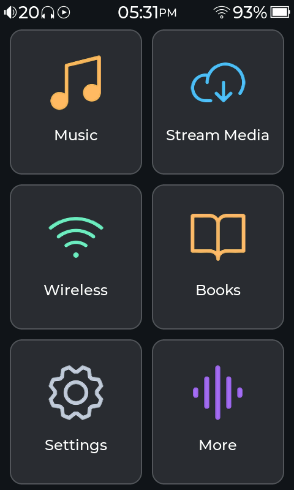
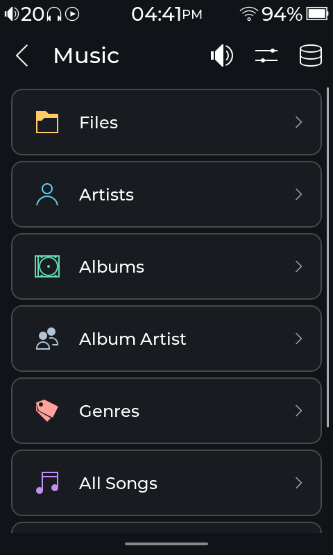
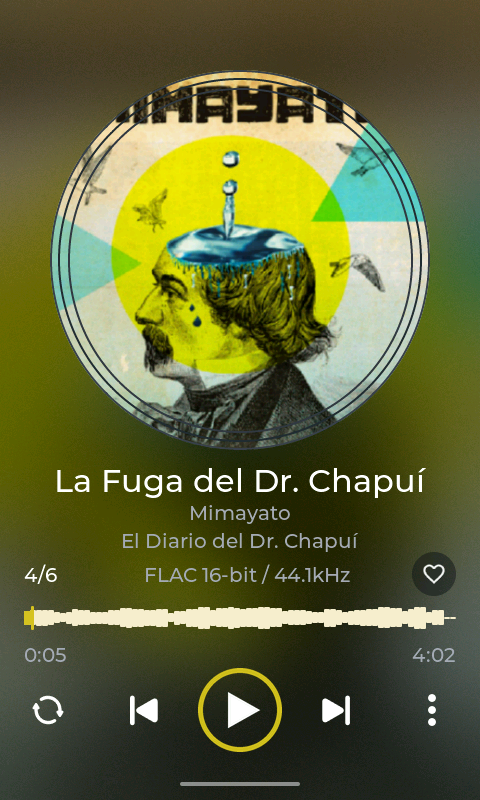
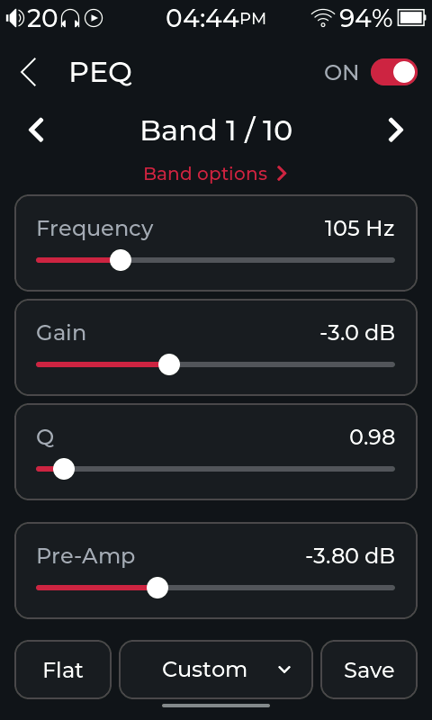
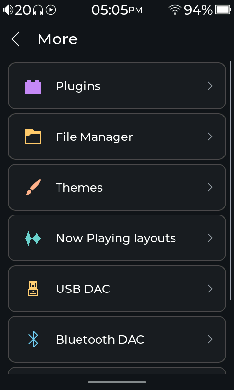

# CompásOS

**Modular by philosophy, keep it simple.**

CompásOS replaces the stock firmware on supported HibyOS devices. Keep it simple for everyday listening, or add the features and appearance you want through plugins, themes and Now Playing layouts.

[Website](https://compasplayer.org) · [User guide](https://compasplayer.org/guide.html) · [Plugins](https://github.com/Starnished66/compas-plugins) · [Developer guides](https://compasplayer.org/developers.html) · [Downloads](https://github.com/Starnished66/compas-player/releases/latest) · [License](LICENSE)

[Support CompásOS on Ko-fi](https://ko-fi.com/starnished)

## Screenshots

<p align="center">
  <a href="images/readme/home.png"></a>
  <a href="images/readme/music.png"></a>
  <a href="images/readme/vinyl-waveform.png"></a>
</p>

<p align="center">
  <a href="images/readme/peq.png"></a>
  <a href="images/readme/more.png"></a>
</p>

## Make it yours

- **Plugins** add tools and services, including AutoEQ, Audiobooks, Podcasts and EPUB Reader.
- **Themes** change colors, icons and Home screen styling.
- **Now Playing layouts** arrange artwork, track details and playback controls.

Install add-ons from **Settings → System → Plugin Manager → Plugin Store**. Choose themes in **More → Themes** and layouts in **Settings → Display → Player Layout → Layout**.

## Listening

Play local music, browse albums and playlists, and follow synchronized lyrics. CompásOS includes gapless playback, crossfade, ReplayGain and a parametric equalizer, plus Bluetooth audio, USB DAC mode, network streaming and remote control.

## Devices

| Device | Build target | Status |
|---|---|---|
| HiBy R1 | `r1` | Full feature pass. |
| HiBy R3 Pro II | `r3proii` | Full feature pass. |
| HiBy R3 II 2025 | `r3ii_2025` | Full feature pass. |
| Tempotec V1 | — | Early build, missing features. |

Use the download for your exact model.

## Install and update

Start with the [installation guide](https://compasplayer.org/guide.html#01-install-and-update). Your first installation needs the full firmware image; [Compás Tools](https://compasplayer.org/#desktop-app) can guide you through it.

For later updates, use **Settings → Updates**. To update from the SD card, save the matching player binary as `SD/.compas/compas_player`. Use full firmware when the release notes require new fonts or graphics. Back up your files and keep power connected during installation.

## Build

Install Git, Make, a C/C++ compiler, CMake, Python 3, patch, curl, xz and pkg-config. For device builds, set up the MIPS musl toolchain:

```sh
toolchain_dir=$(scripts/tools/toolchain/install_mips_toolchain.sh "$HOME/.cache/compas-toolchain")
export PATH="$toolchain_dir/bin:$PATH"
make target BOARD=r1
make bootloader BOARD=r1
```

Use `BOARD=r3proii` or `BOARD=r3ii_2025` for the other models. For the desktop simulator, install SDL2 and run `make host`. Fonts and theme assets are supplied separately. This repository builds executables; firmware images are packaged separately.

## Thanks

Built with help from the HiBy modding community, including [hiby_os_crack](https://github.com/hiby-modding/hiby_os_crack) and [Hiby-R1-Mod](https://github.com/bidhata/Hiby-R1-Mod).

## License

See [LICENSE](LICENSE) and the third-party notices in [`licenses/`](licenses/). Decoder-specific attribution is also kept alongside its source, including the [APE decoder notice](src/audio/decoders/ape/APE_FFMPEG_CORE_LICENSE.txt).
