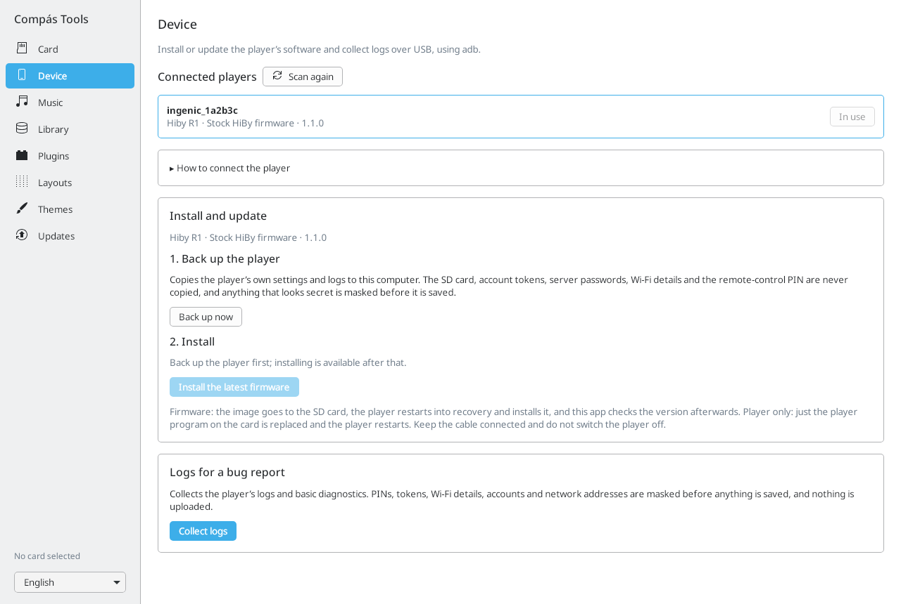

# Install and update

[User manual](README.md)

A full firmware image installs Compás and its bootloader, the small startup program used to install later player updates. After the first full installation, most updates can use the smaller player-only download, which updates the player application. Use the full image when the release notes call for changes to fonts, graphics or other system files.

## Install and manage with Compás Tools

[Compás Tools](https://github.com/Starnished66/compas-tools) is the desktop companion. For a first installation, connect your stock player by USB and let its **Device > Install and update** section prepare and install Compás. You do not need to copy the firmware file yourself.

Before starting, charge the player, leave its microSD card inserted, and back up your music and playlists. Keep a known-good recovery image for your exact model on your computer. Your computer needs internet access to download Compás and, if needed, the connection tools.

### First installation

1. Get Compás Tools from the project page above and open it on your computer.
2. On the stock HiBy player, open **Settings > About**. Tap **About** ten times to unlock the developer options, then turn on **USB debugging (ADB)**. ADB is the USB connection the desktop app uses to install the player software.
3. Connect the player to your computer with a data-capable USB cable. If the player asks to allow this computer, accept on the player.
4. In Compás Tools, open **Device**. If it says **adb is needed**, choose **Download adb…** and confirm the download. Under **Connected players**, check that the app identifies your player and its exact model. Choose **Use this player** if several are listed; a single player is selected automatically. Use **Scan again** if it has not appeared yet.
5. In **Install and update**, choose **Back up now**. This saves selected player settings and logs on the computer; it does not back up your music, passwords or account credentials. Wait for **Backup saved** before continuing.
6. Choose **Install the latest firmware**. Check the model and update file in the confirmation, then choose **Install and reboot**. The app downloads the full firmware, copies it to the player's SD card, and restarts the player into its recovery updater.
7. Keep the USB cable connected and do not switch the player off while the update runs. The app checks the player after it restarts. Follow any instructions it shows if recovery needs to be started manually.
8. Complete the setup screens on the player. Open **Settings > System > About** to check the installed Compás version.



While ADB is enabled, the SD card does not appear as a USB drive on your computer. This is expected. After installation, turn ADB off when you want to use USB storage or USB DAC mode. In Compás, its switch is under **Settings > System > About > Developer Options**.

If the player is not recognized, try another data cable or USB port and check **How to connect the player** in the app. Windows may need the USB driver linked there. Do not select a different model to get past a detection problem.

The R3 versions have not been tested on the actual players. Confirm the recovery procedure for your exact model before a first install: **Power + Volume Up** for R1 and R3 Pro II, or **Power + Play/Pause** for R3 II 2025. Stock firmware versions may differ; use the app's connection guide and your model's recovery instructions if its menus do not match.

### Later updates with the desktop app

On a player already running Compás, enable ADB under **Settings > System > About > Developer Options**, reconnect it, and open **Device > Install and update**. Choose **Update only the player** for a routine player update, then **Update and restart** in the confirmation. Use **Install the latest firmware** when the release notes require fonts, icons or other system changes. Keep the cable connected until the player restarts and the app finishes its checks.

To prepare an update with a card reader instead, select the card in **Card**, then open **Updates**. Choose **Player only** or **Full firmware image**, then **Copy to card**. Safely eject the card and use the matching on-player installation steps below.

## Install a full firmware image manually

Use this alternative if you prefer to prepare the card yourself:

1. Confirm your exact model and download its full `.upt` package from [Compás releases](https://github.com/Starnished66/compas-player/releases/latest).
2. Copy the image to the top-level folder of the microSD card (the card root), named `r1.upt`, `r3proii.upt`, or `r3ii_2025.upt` for the matching model. Keep only the intended update image there.
3. Eject the card safely, return it to the player, and use your model's recovery updater. Follow its prompts, keep the player powered, and let it finish and restart.
4. Complete setup, then check **Settings > System > About**.

For a first installation, use the full firmware image. A player-only SD update requires the Compás bootloader, which the full image installs.

## Update the player from the SD card

1. Download the player file for your exact model.
2. On the card, open or create the hidden `.compas` folder at the card's top level. If your computer hides folders whose names start with a dot, enable showing hidden files to find it.
3. Put the downloaded player file in that folder and name it exactly `compas_player` (no file extension). Its location should be:

   ```text
   SD/.compas/compas_player
   ```

4. Safely disconnect file transfer and open **Settings > Updates > Player Update > Install from SD card**.
5. Let Compás install the file and restart. Check the version under **Settings > System > About**.

The bootloader can also install a player update from this folder automatically at startup. Keep the other contents of `.compas` when adding the file. Compás checks that the file matches your model and may reject a version older than the one included with the firmware. If rejected during startup, the file is kept with `.rejected` added to its name.

A player-only update changes the player application. If the release requires new fonts, icons or other system files, use the full firmware package specified in its release notes.

## Update over Wi-Fi

1. Connect to Wi-Fi with internet access.
2. Open **Settings > Updates > Player Update**.
3. Choose **Check for online update** and follow the download and installation prompts.

For the full firmware, use **Settings > Updates > Firmware Update**. Online firmware installation checks the latest published GitHub release, including when installing a previously downloaded online image. It needs internet access for that check.

## Install a full firmware image offline

1. Copy the matching `.upt` image to the top-level folder of the microSD card (the card root) with the model-specific filename above.
2. Open **Settings > Updates > Firmware Update > Install from SD card**.
3. Confirm the selected image and wait while Compás prepares recovery. The device then reboots into the updater.

Before restarting into the updater, Compás moves other `.upt` files from the card root into another folder. Recovery still checks the image contents; renaming an image for a different model does not make it compatible. Preparation can take a while. Keep power connected and let the updater finish.

## Recover a player that cannot reach Home

Use the known-good full firmware image for your exact model and its recovery updater. On an R1 with Compás, place the intended image in the card's top-level folder and hold **Power + Volume Up** during startup. Reinstalling a full image restores the firmware; if the normal menus still work, [collect the version and update log](11-troubleshooting.md) first.

For stock firmware downloads and manufacturer procedures, use [HiBy's support center](https://store.hiby.com/apps/help-center). Compás's release notes and model compatibility notes take precedence for its own packages.

<!-- Verified against README.md, src/core/updates/firmware_update.h/c, src/core/updates/player_install.c and gui_settings.c update menu. Stock and R3 hardware procedures are not newly device-tested for this edition. -->
