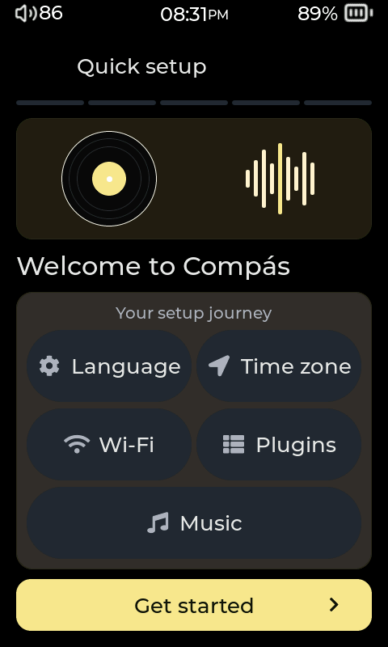
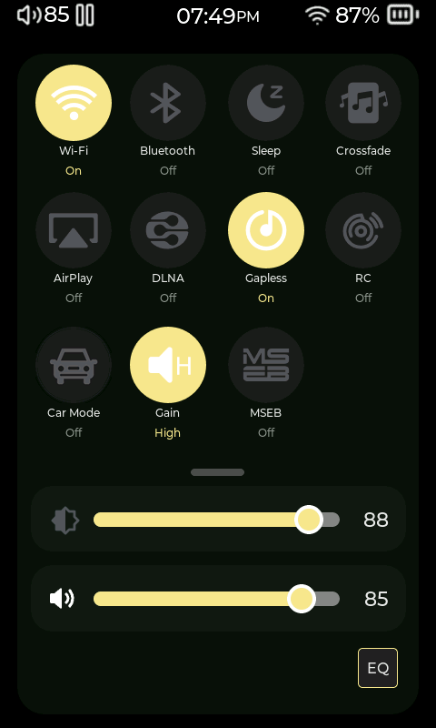

# First steps

[User manual](README.md)

## Finish setup

A fresh installation or factory reset opens the welcome flow.

1. Choose your **Language** and the **Keyboard** layout you want to type with.
2. Select your **Time Zone**.
3. Connect to **Wi-Fi**, or skip it and connect later.
4. Choose the suggested **Plugins**, or browse **More**. You can skip optional installations.
5. Choose a **Player Layout** when that setup page is shown.
6. On **Your music**, scan the card and continue to the player.



You can revisit these choices in Settings. Plugin installation needs an internet connection; local music playback works offline.

## Copy music and scan it

1. Copy your music to the microSD card using a card reader, or select **Settings > System > USB Mode > Storage** before connecting a data cable to your computer.
2. Keep albums together in folders if that is how you prefer to organize them. For example:

   ```text
   Music/
     Artist/
       Album/
         01 - First song.flac
         02 - Second song.flac
         cover.jpg
   ```

3. Eject the card or USB storage safely and return to Compás.
4. Open **Settings > Library > Update Music Database**. Wait for the scan to finish.
5. Open **Music > All Songs** and tap a track.

The library groups music using the title, artist and album information saved inside each file, often called tags. **Music > Files** follows the folders on the card. See [Your music library](03-library.md) for refreshing changed tags and covers.

## Find your way around


The default Home screen has **Music**, **Stream Media**, **Wireless**, **Books**, **Settings**, and **More**. Older screenshots may show **DAC** where the current interface shows **More**. Themes and plugins can customize Home.

| Control | Action |
|---|---|
| Tap a tile or row | Open it or choose the item. |
| Drag a list vertically | Browse more rows. |
| Back arrow in a page header | Return to the previous page. |
| Swipe right while browsing | Go back; sliders and other drag controls keep their own gestures. |
| Swipe left while browsing | Open Now Playing. |
| Swipe up from the bottom Home indicator | Return Home when **Swipe Up for Home** is enabled. |
| Pull down from the top of the display | Open the Quick Drawer when enabled. |
| Tap the album cover in Now Playing | Open or close lyrics when lyrics are enabled. |

## Play your first album

1. Open **Music > Albums** and select an album.
2. Tap a track to start from it, or use the album's play options.
3. Swipe left to **Now Playing** if you are still browsing.
4. Use play/pause, previous and next. Drag the seek bar to change position.
5. Tap the heart to mark the track as a favorite. Use the queue control, or **Music > Playlists > Queue**, to see playback order.


Layouts can move these controls or replace some of them for audiobooks and podcasts. See [Personalize Compás](08-personalize.md) to choose a layout.

## Use quick controls and physical buttons

Pull down from the top to open the Quick Drawer. It gives access to brightness, volume, playback and enabled quick toggles. Use its handle to reveal more controls, and slide it up to close.



Use the player's volume and playback buttons as labeled. **Settings > Playback & Controls > Buttons & Remote > Button Mapping** shows the buttons available on your model and lets you change supported tap, double-tap and hold actions. Custom mappings and the lock-screen plugin can change the behavior you expect from a button.

Continue with [Playback](04-playback.md) or [Your music library](03-library.md).

<!-- Verified against gui_setup.c setup steps, gui_shell.c Home/gesture/drawer handlers, gui_navigation.c, gui_player.c cover tap/transport and gui_settings.c. Images retain legacy layout. -->
