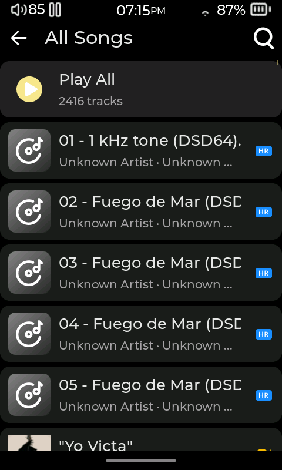
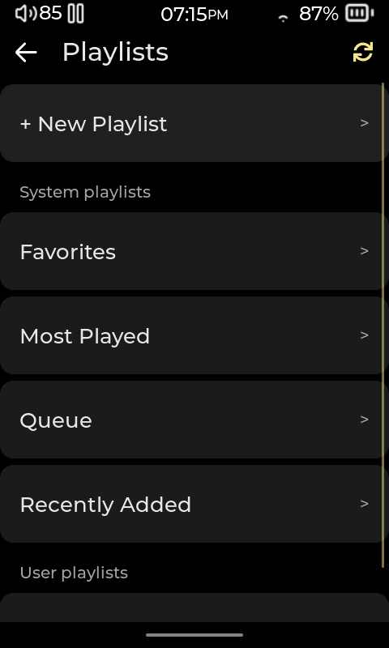

# Your music library

[User manual](README.md)

## Scan music and refresh information

1. Copy music to the player's music storage or insert the card that contains it.
2. Open **Settings > Library > Update Music Database** to add new music to the library and update its song list.
3. If song details stored in music files (called tags) or artwork have changed, use **Refresh All Metadata** or **Refresh All Covers** in the same Library settings page.

Scanning makes tracks available to the library views. The **Files** browser can also be used to browse folders directly.

## Browse and search

1. Open **Music** from the Home screen.
2. Choose **Artists**, **Albums**, **Genres**, **All Songs**, **Playlists**, or **Recently Added**.
3. Open an artist or album to see its tracks. Tap a track to start playback from that point.
4. In **All Songs** or **Recently Added**, use the search control to find a song by its displayed title. In **Artists** or **Albums**, search for the displayed artist or album name. In **Files**, search folder and file names. Clear or close search to return to the list.

The **Playlists** page also includes **Favorites**, **Most Played**, **Queue**, and **Recently Added**. **Favorites** lists tracks marked with the heart on the player. **Most Played** is generated from listening history. **Queue** is the list of tracks lined up for the current listening session. These pages are library lists, not saved M3U playlists.

## Manage favorites and playlists

1. While a track is playing, tap its heart to add or remove it from **Favorites**.
2. To make a playlist, open a track's menu and choose **Add to Playlist**, then choose **+ New Playlist** and enter a name. To add it to an existing playlist, choose that playlist from the same list.
3. To add several tracks, repeat **Add to Playlist** for each track. A track's menu also has **Add to Queue**. The queue lines tracks up for the current listening session; a saved playlist keeps a named list for later.
4. Open a saved playlist to play a track. To rename or delete the playlist, return to **Playlists**, press and hold its name, then choose **Rename Playlist** or **Delete Playlist**. To remove tracks from an editable playlist, open it and tap **Edit**.
5. Tap the track checkboxes to select items, or use **Select all**. Tap the delete control to remove selected entries, then confirm if prompted. **Done** leaves selection mode.
6. To change playlist order, use the row handles while editing and drag a track to its new position. This reorders the playlist entries; it does not move music files.

Deleting a playlist removes its playlist file, while the music files remain. The built-in **Favorites** and generated collections are not ordinary editable playlists.

## Files and track menus

1. Open **Files** to navigate folders on the music storage.
2. Open a folder or track. A track's menu provides actions such as **Add to Queue**, **Add to Playlist**, and **Refresh metadata**.
3. Use **Refresh metadata** when a track's information needs updating. For embedded artwork changes, use the cover refresh options under **Settings > Library**.

Playlist entries are stored separately from the audio files. The built-in library reads song details (tags) and associated artwork from your music. Extra menu items added by plugins are documented in the Plugins chapter.

<!-- Sources: src/ui/gui_library.c (build_music_submenu, build_playlists_screen, group_songs_edit_btn_cb, group_songs_reorder_handle_cb, open_song_context_menu, library scan/settings actions); src/ui/gui_player.c (favorite_icon_event_cb); src/ui/gui_queue.c (queue menu). -->
