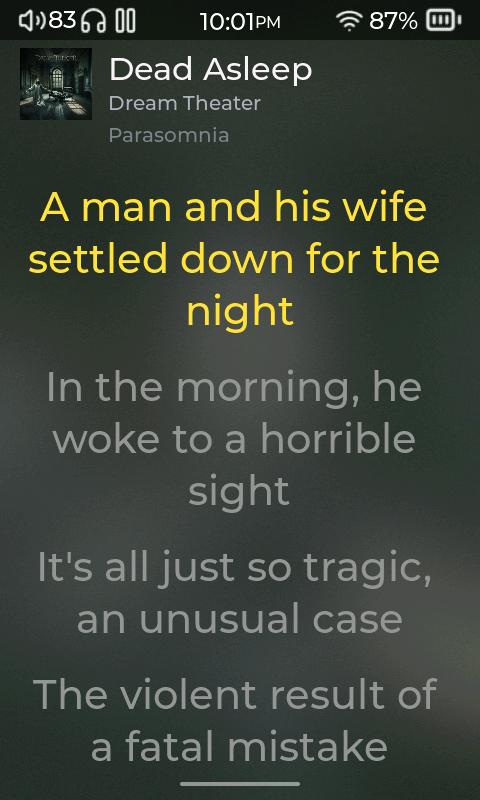
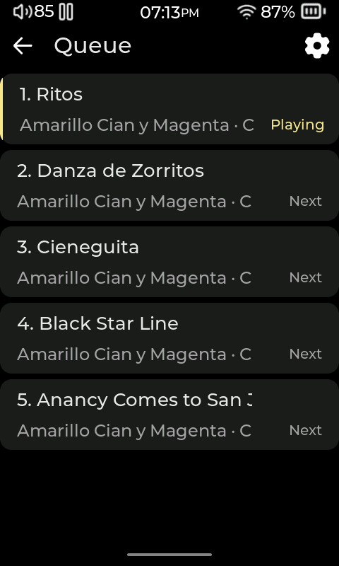

# Playback

[User manual](README.md)

## Control the current track

1. Tap a song in **Music** or **Files** to start it.
2. Open **Now Playing** to see the track, artist, album art and playback controls. To view the available details for the current track, tap the three-dot menu and choose **Information**.
3. Use the previous, play/pause and next controls to move through playback. Tap the heart to add or remove the track from **Favorites**.
4. Open the queue from **Playlists > Queue** to see tracks lined up for playback. The queue can include tracks added from their menus with **Add to Queue**.

The queue is the list of tracks lined up to play, in playback order. A saved playlist keeps a named list you can return to later.

## Choose a play mode

Tap the play-order icon on **Now Playing** to cycle through these modes. The player shows the name of the mode you selected.

| Mode | What happens |
|---|---|
| **Sequential** | Plays through the queue in order, then stops. |
| **Repeat all** | Starts the queue again when it reaches the end. |
| **Repeat one** | Repeats the current track. |
| **Shuffle + repeat** | Keeps playing in shuffled order. |
| **Shuffle once** | Plays the queue in shuffled order, then stops. |

When starting an album or another library list, choose **Start sequentially** or **Shuffle from a random song** from its play options.

## View lyrics and track details

1. On **Now Playing**, tap the album cover to open lyrics. Tap the cover again to close lyrics.
2. To enable or disable the lyrics view, open **Settings > Display > Player Layout > Lyrics**.
3. The player reads timed lyrics from a separate `.lrc` file with the same name as the song, for example `song.flac` with `song.lrc`. It can also display lyrics stored in supported music tags.

The **Information** screen shows available track details. Artwork can be refreshed from **Settings > Library > Refresh All Covers** if it has changed.

## Choose what happens between tracks and after a restart

Open **Settings > Playback & Controls** for these independent choices:

- **Resume Last Track** controls whether and how playback resumes when you start the player.
- **Gapless** removes the added pause between tracks, useful for albums whose tracks run into one another.
- **Crossfade** blends the end of one track with the beginning of the next. It works together with **Gapless**.

For a listening countdown, open **Settings > Power > Sleep Timer**, turn on **Enable Sleep Timer**, and choose a duration. Playback pauses when the timer expires.

For loudness adjustment, see [ReplayGain in Sound](05-sound.md#keep-playback-levels-consistent-with-replaygain). Audiobook and podcast plugins can add speed, seek and resume controls; see [Books, audiobooks and podcasts](09-books.md).

<!-- Sources: src/ui/player/screen/gui_player.c (play-mode cycle, lyrics and favorite controls); src/ui/player/screen/gui_queue.c (Queue screen and actions); src/ui/settings/gui_settings.c (Playback & Controls, sleep timer, Lyrics setting). -->
