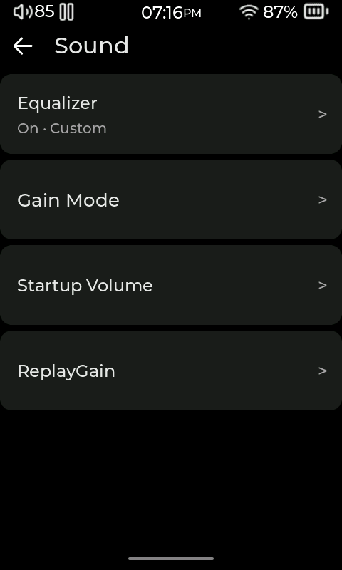
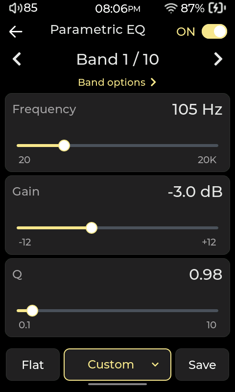
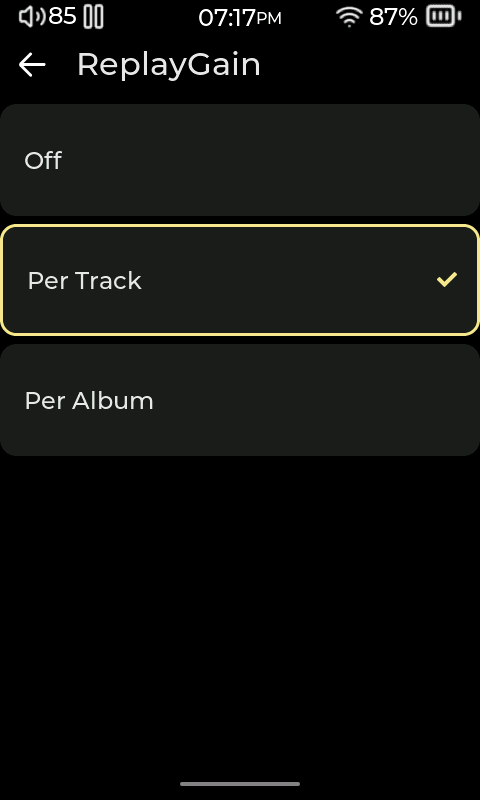

# Sound

[User manual](README.md)

Open **Settings > Sound** to adjust tone, playback level and the player's audio output. You can use the default settings without configuring any of the advanced controls.

## Adjust the equalizer

The equalizer changes the balance of bass, midrange and treble. Compás has a 10-band **parametric equalizer**, or **PEQ**: each band lets you choose which frequencies to change and by how much.

1. Open **Settings > Sound > Equalizer**.
2. Use the band arrows to choose the band you want to adjust.
3. Adjust its controls using the guide below. **Band options** opens the filter choices.
4. Use **Save** to keep your settings as a profile you can recall later.

| Control | What it changes |
|---|---|
| **Frequency** | Where the adjustment is centered, from low bass to high treble. |
| **Gain** | How much that band is boosted or reduced. |
| **Q** | How wide the adjustment is. A higher Q affects a narrower range. |
| **Pre-Amp** | The overall level before the equalizer's adjustments. |

Tap the current profile name at the bottom of the equalizer to open **Profiles** and load or manage saved settings. For headphone profiles from an installed add-on such as AutoEQ, open **Settings > Sound > Download Profiles**. Downloading needs internet access.

## Keep playback levels consistent with ReplayGain

**ReplayGain** uses loudness information saved in your music files to adjust playback level. Open **Settings > Sound > ReplayGain** and choose:

| Mode | Use it to |
|---|---|
| **Off** | Play without a ReplayGain adjustment. |
| **Per Track** | Bring individual songs closer to the same loudness, useful when mixing tracks from different albums. |
| **Per Album** | Adjust each album as a whole, preserving the intended loudness differences between its tracks. |

The files need suitable ReplayGain information for this to work. Compás adjusts playback without rewriting your music files.

## Set volume limits

**Startup Volume** controls the level used when the player starts. **Max Volume** sets the highest level you can select. Both are under **Settings > Sound**.

## Crossfeed for headphones

**Settings > Sound > Crossfeed** mixes a filtered part of each stereo channel into the other. You can adjust its amount and **Crossfeed angle**, independently of the equalizer.

## Advanced output settings

Some models show **Settings > Sound > Local DAC Settings**. The DAC is the hardware that turns digital audio into the signal for your wired headphones.

These controls offer hardware filters and **NOS Mode** (non-oversampling). NOS bypasses interpolation and ignores the selected filter. They affect local PCM playback, which includes ordinary FLAC and MP3 tracks; changes apply when playback restarts. **DRE** (Dynamic Range Enhancement), when offered, applies to local PCM and DSD playback. These options are separate from equalizer profiles.

## Optional sound tools

Installed plugins may add **Sound Effects**, gain choices or downloadable headphone profiles. See [Plugins](07-plugins.md) to install and find them.

<!-- Sources: gui_settings.c equalizer/footer/Profiles/Crossfeed/volume/DAC builders; gui_network.c replaygain_mode_options; audio PEQ controls. UI labels retained; parameter explanations added for readers. -->
