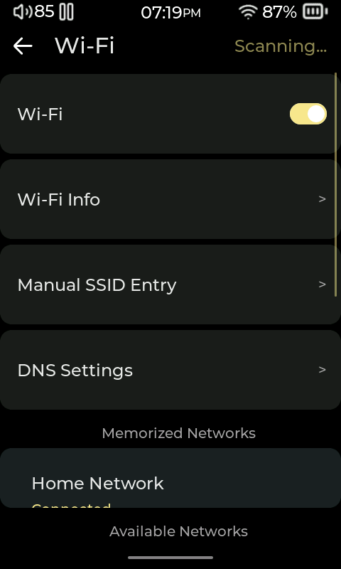
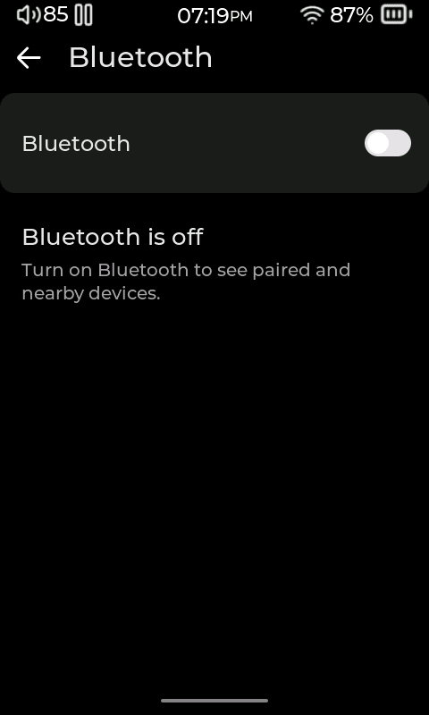
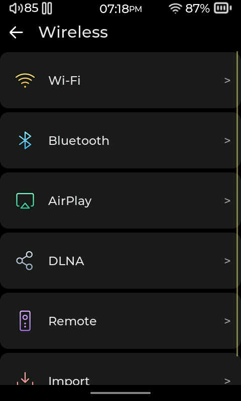
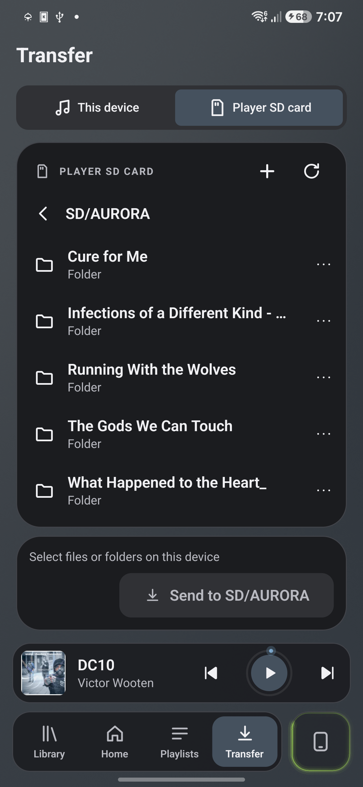

# Connections

[User manual](README.md)

Choose the section for what you want to connect. **Bluetooth headphones** play music from Compás. **USB DAC** and **Bluetooth DAC** let you listen to audio sent by another device through the player's output.

## Connect to Wi-Fi

1. Open **Wireless > Wi-Fi** and turn **Wi-Fi** on.
2. Select your network and enter its password. If the network is hidden, use **Manual SSID Entry**; SSID means the network's name.
3. Use **Wi-Fi Info** to check the connection details.

Internet access is needed for online updates, plugin downloads and online services. Remote control and music servers on your own network can work without internet access.

## Listen with Bluetooth headphones or a speaker

1. Put the headphones or speaker into pairing mode.
2. Open **Wireless > Bluetooth** and turn Bluetooth on.
3. Select the device from the nearby devices list to pair and connect.
4. Play a track in Compás. Previously paired devices appear in their own list when you want to reconnect.

To send music in the other direction, from a phone to the player, open **More > Bluetooth DAC**. This is a separate receiving mode; leave it when you want to return to playing the player's library.

## Copy files over USB

Select **Settings > System > USB Mode > Storage**, then connect the player to your computer with a data-capable cable. Open the SD card on the computer, copy your files, and eject it safely before disconnecting.

If the card does not appear, check the USB mode and reconnect the cable. If **ADB** is enabled under **Settings > System > About > Developer Options**, turn it off: this developer connection takes over the USB port while enabled.

## Use the player as a USB DAC

A USB DAC lets you listen to computer audio through the player's headphone output.

1. Connect the player to the computer over USB.
2. Open **Settings > System > USB Mode > USB DAC**, or **More > USB DAC**.
3. Select the player as the computer's audio output if it is not selected automatically.
4. Leave USB DAC mode on the player when you have finished.

ADB must be off before USB DAC can use the port.

## Send audio over your home network

Connect the player and the sending device to the same Wi-Fi network, then enable the receiver you want:

| To send from | On Compás | On the sending device |
|---|---|---|
| An iPhone, iPad or Mac using AirPlay | Open **Wireless > AirPlay** and turn it on. | Select the player as the AirPlay destination. |
| An app that supports DLNA/UPnP casting | Open **Wireless > DLNA** and enable **DLNA Renderer**. | Choose the player as the destination and select music to send. |

The player receives the audio and plays it through its own output. The sending app determines which playback controls are available.

If the player is not listed, check that both devices are on the same network. Guest networks sometimes prevent devices from finding one another.

## Control Compás from a phone or browser

### Use the Compás Remote app

1. On the player, open **Wireless > Remote** and turn on **Remote Control**. Note the displayed **Connection PIN**. Connect the phone and player to the same Wi-Fi network; guest networks may prevent them from finding each other.
2. In Compás Remote, choose **Connect a player**, or open **Settings > Connection and players** if a player was saved before. Choose **Wi-Fi**, select the player listed under **On this network**, then connect. If it is not listed, choose **Enter an address instead** and enter the address shown on the player. Enter the player's Connection PIN when prompted.
3. You can also choose **Bluetooth** on Android and pair with the player from the app. This connection can control playback without Wi-Fi, but file transfer requires Wi-Fi. Pairing the phone for Bluetooth audio alone does not connect the remote.

The app's four tabs are along the bottom:

| Tab | What it does |
|---|---|
| **Library** | Browse the player's music by albums, artists, songs and other categories. |
| **Home** | See the current track and playback controls. |
| **Playlists** | Open, create and edit playlists on the player, or import a playlist file. Automatically maintained lists, such as Most Played, are read-only. |
| **Transfer** | Send music from the phone to the player's SD card over Wi-Fi. |

The Now Playing controls let you play or pause, skip tracks, seek, adjust volume, shuffle and change repeat mode. Open **Up next** to review the queue. Open **Settings** from the Home screen to change the app's language or appearance, or to manage the connection. If the PIN is rejected, open **Settings > Update saved PIN** and enter the PIN currently shown in the player's remote settings.

### Transfer music from your phone

1. Connect to the player over Wi-Fi and open **Transfer**.
2. In **Player SD card**, open the destination folder. Use **+** to create a folder if needed.
3. Switch to **This device**, browse to your music, and select the files or folders to send. Allow access to your files if Android asks.
4. Check the destination named in **Send to**, then choose it to begin. Keep both devices connected until the transfer finishes.

Existing files are skipped rather than overwritten. If the connection drops, wait for the app to reconnect and check the transfer result before retrying.

In **Player SD card**, a row’s three-dot menu offers **Rename** and **Delete**. Deleting here removes the actual file from the SD card; it is different from removing a song from a playlist.

### Use a browser

For a browser remote, enable **Remote Control** in **Wireless > Remote** on the player, then scan the player's QR code with the phone camera or open the displayed address in a browser on the same network. Enter the Connection PIN if requested. If the phone cannot find the player, check that both are on the same Wi-Fi network and that the network allows devices to communicate.

## Play from a Subsonic music server

Subsonic is a way to browse and play music stored on a server rather than on the SD card. You need the server's address and an account with access to its music.

Open **Subsonic** from **Stream Media** and enter the connection details, or choose a saved server. A server on your home network needs a working local connection; an online server also needs internet access. Tidal and Qobuz are available through optional [plugins](07-plugins.md) with their own account requirements.

<!-- Sources: gui_network.c Wireless/Wi-Fi/Bluetooth/Remote/DAC builders; gui_settings.c System/More/Developer Options; gui_subsonic.c connection screen; ../compas-app/src/ui/screens/{ConnectionScreen,TransferScreen,PlaylistsScreen}.tsx and ui/sheets/SettingsSheet.tsx. -->
