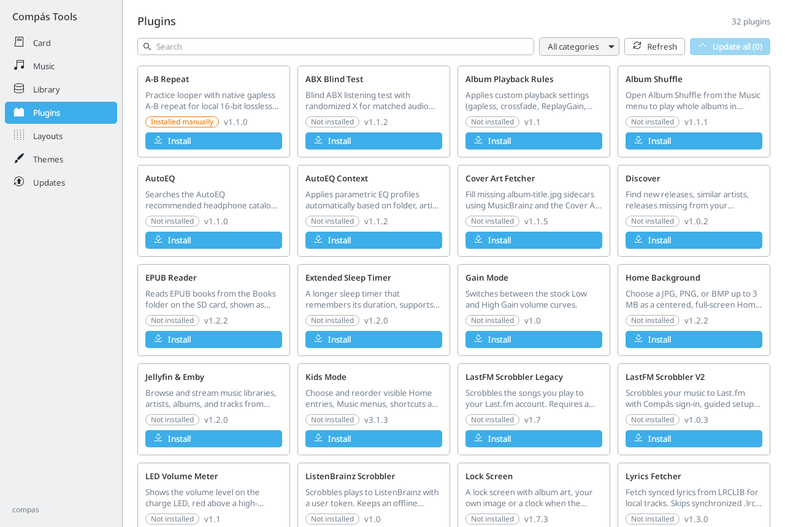
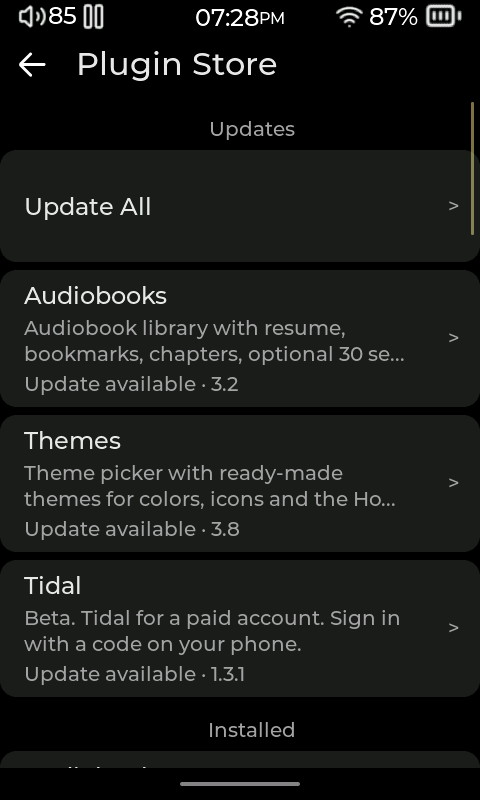
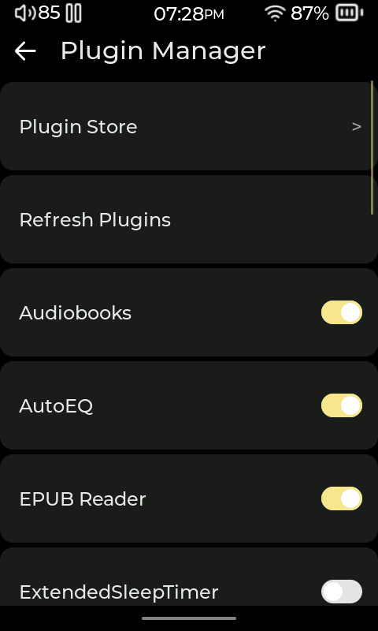

# Plugins

[User manual](README.md)

Plugins are optional add-ons that give the player extra features, such as audiobook tools, podcast downloads, streaming services, and different screen layouts. Wi-Fi, Subsonic streaming, AirPlay and DLNA receiving, plain-text books, and USB/Bluetooth audio modes are already part of the player. Tidal, Qobuz, lyrics and cover-art tools, Audiobooks, Podcasts, and EPUB Reader are examples of add-ons. The available add-ons can change over time.

## Install and update from your computer

[Compás Tools](https://github.com/Starnished66/compas-tools) is an easier way to browse and manage add-ons on a larger screen. Unlike its USB **Device** installer, the add-on catalog works with an SD card mounted as a drive on your computer.

1. Connect the card through a card reader, or turn ADB off on the player and connect in **USB Mode > Storage**. Select the card in Compás Tools' **Card** screen.
2. Open **Plugins**, **Layouts**, or **Themes**. Search for an add-on and open it to read its details.
3. Choose **Install** for a new add-on or **Update** for an installed one. To apply the available updates together, choose **Update all**. The app copies the package's files, including any icons or layouts it needs.
4. Wait for the operation to finish, safely eject the card, and return to the player. Refresh plugins or restart the player to load the changes. Choose installed themes and layouts in their respective pickers.

An installed plugin's details include an enable/disable switch and **Uninstall**. Turning it off keeps its files; uninstalling removes the installed package. Themes and layouts are selected on the player rather than enabled with a plugin switch. If an add-on needs newer player software, use the [desktop update workflow](01-install-and-update.md#later-updates-with-the-desktop-app) first.

The on-player Plugin Store and manual installation steps below remain available.

## Browse and install from the Plugin Store

1. Connect the player to Wi-Fi with internet access.
2. Open **Settings → System → Plugin Manager → Plugin Store**.
3. Browse the list and tap an entry to read its description. Choose **Install** for a new add-on or **Update** when an update is available, then follow any confirmation prompt.
4. After installation, the player refreshes its add-ons. Look for the feature in the menu named in its description. Many appear under **More**, **Music**, **Books**, or **Settings**. Layouts and themes appear in their pickers.

The Store may offer **Replace** when an installed file differs from the version it provides. Review the prompt before replacing it. An entry marked **Needs newer firmware** requires a newer player update; installing the add-on cannot meet that requirement. To review available updates, use the updates entry in the Store when shown, or **Settings → Updates → Plugins & Layouts**.

## Enable, disable, refresh, or remove

Open **Settings → System → Plugin Manager**. The list shows add-ons found on the card. Use a switch to turn an add-on on or off. The change takes effect after leaving the screen and the player refreshes. An entry marked **Not loaded** or **Not loaded: limit reached** is not running; turning off other add-ons can free space for it. Choose **Refresh Plugins** to check again after copying files by hand.

To delete an add-on installed from the Store, open **Plugin Store**, select its entry, and choose **Remove**. This deletes its installed files, though its saved settings may remain on the card. Turning an add-on off only stops it from running; its files stay available if you want to use it again.

## Install an add-on manually

Use these steps for an add-on downloaded from the [compas-plugins catalog](https://github.com/Starnished66/compas-plugins):

1. Copy the add-on's `.lua` file to the SD card's `.plugins` folder. Create that folder if needed.
2. Copy any other files listed for the add-on to the specified folders on the SD card. Many add-ons also need images, layouts, or other files.
3. Safely reconnect the card, then choose **Refresh Plugins** in **Settings → System → Plugin Manager**, or restart the player.
4. Return to Plugin Manager and turn on the new entry if it is off. Open the menu described for that add-on to use it.

Copy all files from the download and keep them in the folders provided. Copying only the `.lua` file can leave an add-on without its icons or layouts. Store downloads can also include themes or Now Playing layouts; choose those in their pickers rather than looking for a switch in Plugin Manager. Check that an add-on works with your player update before installing it. The [compas-plugins catalog](https://github.com/Starnished66/compas-plugins) lists add-ons and any files they need.

## Find common add-ons

After installing and turning on an add-on, start here:

| Add-on | Where to start | What to do |
|---|---|---|
| Album Shuffle | **Music > Album Shuffle** | Confirm **Start Album Shuffle**, or cancel. |
| Lyrics Fetcher | Now Playing's three-dot menu, or **Settings > Library** | Fetch lyrics for the selected track. The viewer itself is built into the player. |
| Cover Art Fetcher | Now Playing's three-dot menu, or **Settings > Library** | Fetch artwork for the current album; its settings also manage downloaded artwork. |
| AutoEQ | **Settings > Sound > Download Profiles > AutoEQ** | Search for your headphone model and review a profile before applying it. |
| Lock Screen | **Settings > Display > Lock Screen** | Configure lock behavior and background, then use **Preview lock screen**. |
| Metronome | **More > Metronome** | Set tempo, rhythm and sound, then start it. Starting the metronome replaces current music playback. If More cannot host the entry, look under **Playback & Controls**. |

Audiobooks, Podcasts and EPUB Reader have a [separate guide](09-books.md).

<!-- Sources: src/ui/settings/gui_settings.c (System and Updates menus); src/ui/plugins/manage/gui_plugin_manage.c (Plugin Manager, toggle, refresh, entries); src/ui/plugins/manage/gui_plugin_store.c (install/update/replace/remove, compatibility); ../compas-plugins/README.md (manual installation destinations and catalog); README.md (examples of built-in and optional features). -->
