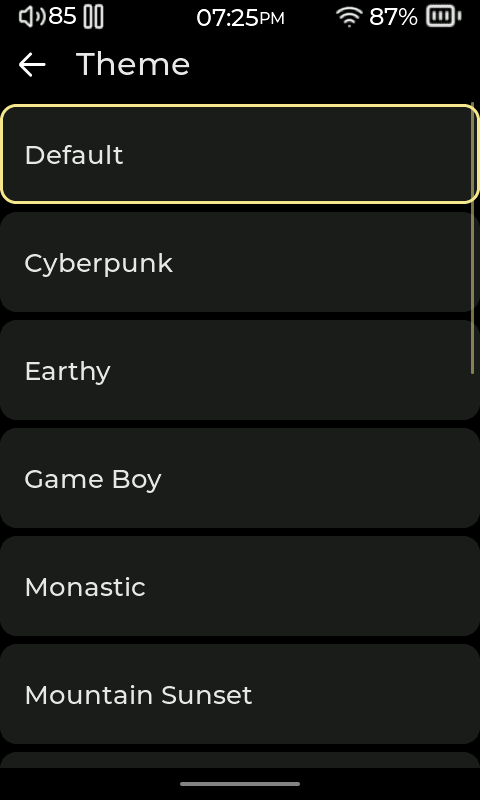
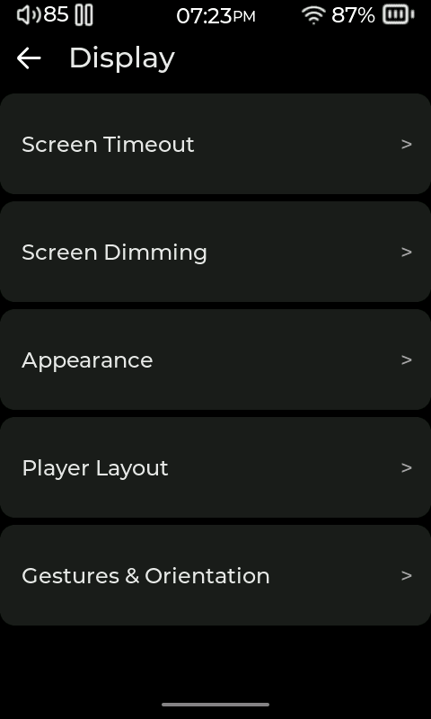
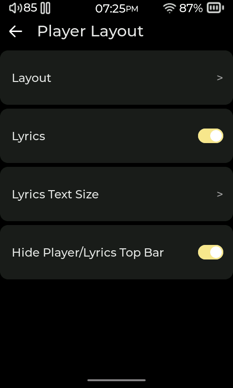

# Personalize Compás

[User manual](README.md)

Themes change the look across the interface. Now Playing layouts arrange the artwork and controls on the player screen. [Plugins](07-plugins.md) add features and tools. You can choose each separately.

To manage catalog themes and layouts on a computer, [Compás Tools](https://github.com/Starnished66/compas-tools) can install them to a selected SD card from its **Themes** and **Layouts** screens. Safely eject the card, return it to the player, then choose the installed item in its picker as described below. You can also use the on-player Plugin Store.

## Change the look

### Choose a theme

Open **Settings > Display > Appearance > Themes** and select a theme. You can also use **More > Themes**. The theme picker is built in, so you can use it without installing an add-on.

Find more themes in the Plugin Store. If you copy theme files from a computer, put them in `SD/Themes/`; subfolders are supported. After installing a theme, select it in the theme picker.

### Adjust fonts and appearance

Open **Settings > Display > Appearance** to adjust the interface. Choose **Accent Color** for the highlight color, **Font** for a custom font, and **Font Size** for the app's text size. To use a custom font, put a `.ttf` file in the SD card's `Fonts` folder, then select it under **Font**. Custom fonts apply to Latin-alphabet text, such as English and Spanish. Other writing systems keep their built-in fonts. Choose **Keyboard** to select the on-screen keyboard layout.

## Choose a Now Playing layout

Open **Settings > Display > Player Layout > Layout** and choose a design. The picker includes built-in and installed layouts; **Download** opens the layout catalog. After downloading a layout, select it in the picker. Choose **Default** to return to the standard player screen.

Layouts change the Now Playing screen, including its artwork and controls. They are separate from the theme used throughout the player. An installed package may include a theme, a layout, or both; choose each in its own picker.

The **Lyrics** switch and **Lyrics Text Size** are also on the **Player Layout** page. **Hide Player/Lyrics Top Bar** hides the status bar on those screens.

## Arrange Home, Music, and the Player

- Under **Appearance > Quick Drawer**, turn the drawer on or off, choose which controls appear, and reorder the controls. The Quick Drawer opens by swiping down from the top edge of the screen. The bottom Home indicator is used for the Home gesture.
- Under **Appearance > Music menu**, choose which Music entries are shown and reorder them. This changes the Music menu, not the Home screen.
- Under **Appearance > Top Bar**, show or hide status items, enable **Battery Percentage**, and choose **Clock Position**.
- **Appearance > Artist Images** shows or hides artist artwork in supported library views.

## Gestures and orientation

Open **Settings > Display > Gestures & Orientation** to enable **Swipe Up for Home**, change **Animation Speed**, or turn on **Upside Down Screen**. Available swipe behavior depends on the screen; for example, the lock screen has its own swipe-to-dismiss interaction.

The player includes a basic lock screen. Install and turn on the Lock Screen add-on to add **Settings > Display > Lock Screen**, where you can adjust its background and behavior. The options available there may vary.

<!-- Sources: src/ui/gui_settings.c (build_settings_display_screen, build_settings_appearance_screen, build_settings_player_layout_screen, build_settings_gestures_screen, build_topbar_settings_screen, custom-font picker); src/ui/gui_shell.c (Home and Quick Drawer gesture zones); src/ui/gui_lock_screen.c; ../compas-plugins/plugins/LockScreen/LockScreen.lua (display settings row); README.md (Themes folder and Plugin Store). -->
