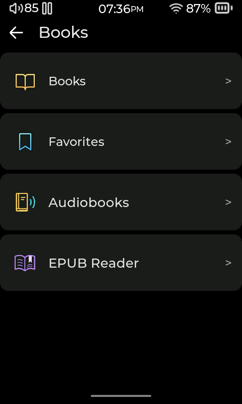
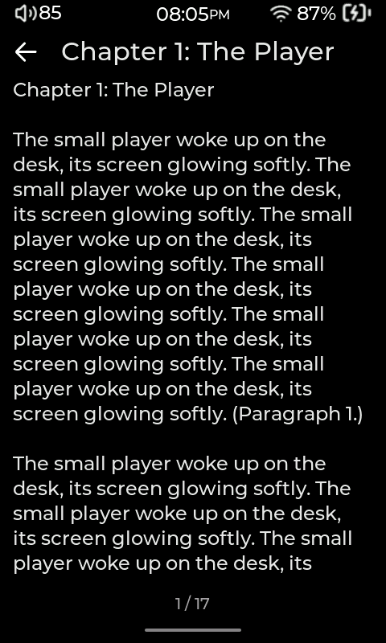
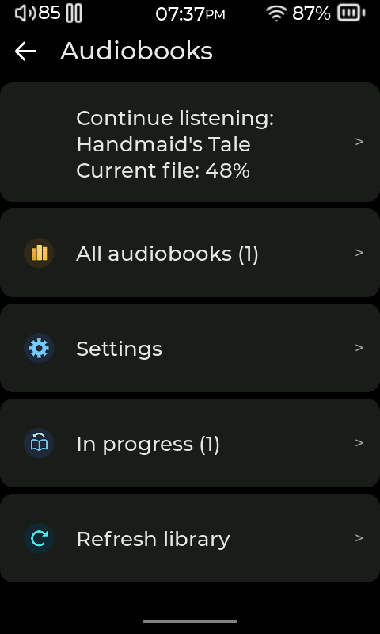
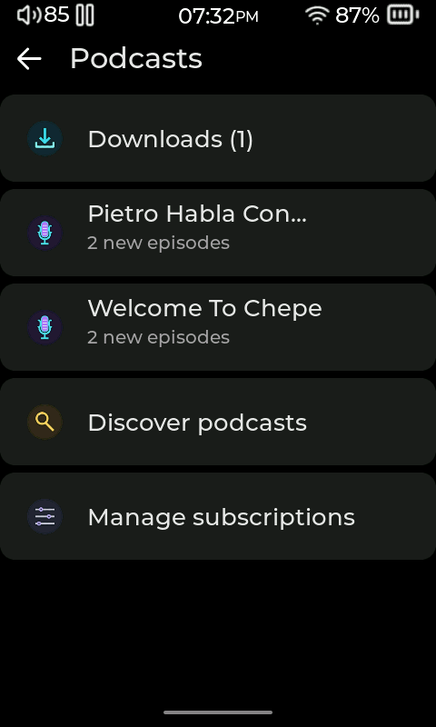

# Books, audiobooks, and podcasts

[User manual](README.md)

Compás includes a basic reader for plain-text files. EPUB reading, audiobook shelves, and podcast tools are supplied by optional plugins. Install **EPUB Reader**, **Audiobooks**, or **Podcasts** from **Settings → System → Plugin Manager → Plugin Store** to add those features. After installation, open the plugin from its menu entry; some plugin entries also appear on the Books screen.

## Read plain-text books

1. Copy `.txt` book files into the `Books` folder on the SD card.
2. Open **Books → Books**, then choose a file to open it in the built-in text reader.
3. Scroll through the text. Tap the favorite control in the reader to add or remove the current file from **Books → Favorites**.

The built-in reader handles plain text. It does not open EPUB files; use the optional EPUB Reader plugin for those.

## Read EPUB books (optional plugin)

Install and enable **EPUB Reader**, then place unencrypted `.epub` books in the SD card's `Books` folder. Open **EPUB Reader** from the Books area to browse books and chapters. The plugin can show book covers and chapter pictures, and saves your reading position so you can continue later. Encrypted or DRM-protected EPUB files are not supported.

## Listen to audiobooks (optional plugin)

Install and enable **Audiobooks**, then put audio files in an `Audiobooks` folder on the SD card. You can keep a book's chapters together in a folder; author and series folders can help organize large libraries. Open **Audiobooks** in the Books area and browse the available files or shelves.

Audiobooks saves listening progress and supports bookmarks, chapter selection where chapters are available, and a sleep timer. Some player layouts supplied with the plugin add playback speed and short seek controls. The exact controls depend on the chosen layout and the player's firmware capabilities. For predictable browsing, use one folder per book and keep disc or part folders inside that book.

## Find and download podcasts (optional plugin)

Install and enable **Podcasts**. Connect to Wi-Fi, open **Podcasts** (usually under **Stream Media**), and use its search or subscription options to find a show. Choose an episode to stream or download; downloaded episodes are available for playback from the device and can be managed from the plugin's download tools. Podcast search, feeds, and downloads need network access. Stream playback does not save a resume position; downloaded episodes can resume.

The plugin offers playback speed for downloaded episodes when the player firmware supports it. Download management includes played and unplayed views. Use the plugin's delete controls when you want to remove files; downloads are not automatically pruned.

<!-- Sources: src/ui/library/collections/gui_books.c (native Books, Favorites, text reader and Books folder); ../compas-plugins/plugins/EpubReader/store.json and EpubReader.lua (Books folder, EPUB reader and saved position); ../compas-plugins/plugins/Audiobooks/store.json and Audiobooks.lua (playback features/layouts); ../compas-plugins/plugins/Podcasts/store.json and Podcasts.lua (search, subscriptions, downloads, resume and speed); docs/guides/audiobook-podcast-workflows.md (download and playback behavior). -->
