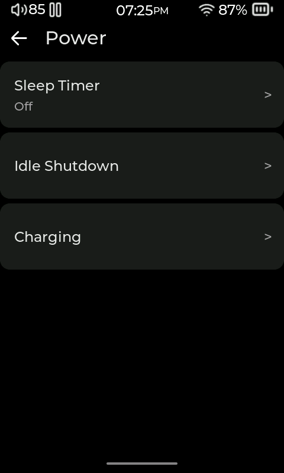
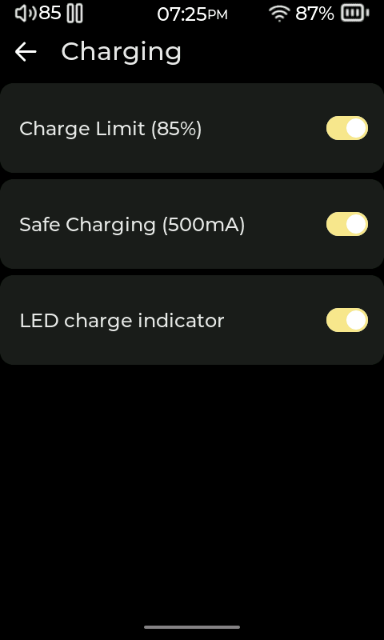

# Power, charging, and screen behavior

[User manual](README.md)

## Charging preferences

Open **Settings > Power > Charging** to set charging behavior:

- **Charge Limit (85%)** limits charging to around the displayed 85% level.
- **Safe Charging (500mA)** limits the charging current to 500 mA.
- **LED charge indicator** controls the charge indicator light.
- On models that show **Disable charging in USB DAC mode**, turn it on to stop charging while you use USB DAC.

## Screen timeout and dimming

Open **Settings > Display > Screen Timeout** and enable **Turn off screen automatically**. Adjust the slider to choose when the display turns off after inactivity. Turn the switch off to disable automatic screen-off.

Open **Settings > Display > Screen Dimming** and enable **Dim screen before timeout** to dim the display before the selected screen timeout. Set the dimming delay with its slider. When screen timeout is enabled, the dimming delay must occur before the screen turns off; the available slider range adjusts accordingly.

## Sleep timer and idle shutdown

**Sleep Timer** sets a countdown for playback. Find it in **Settings > Power > Sleep Timer** or in the Quick Drawer. When it expires, playback pauses, so you can resume later. You can cancel it or change the remaining time while it is active.

**Idle Shutdown** controls what happens after the player has been idle. Turn on **Automatically go idle**, choose **Power Off** or **Suspend to RAM**, and set the **Idle timeout**. Choose suspend if you want the player to enter its low-power state instead of powering off.

## Car Mode

Open **Settings > Playback & Controls > Car Mode**. Car Mode is useful with an in-car power connection: it can resume playback when the player starts and uses its own volume setting. Review the on-screen options before enabling automatic resume.

The **Power** menu can also be opened with a mapped hardware button where supported. The available physical buttons vary by player model; use **Settings > Playback & Controls > Buttons & Remote > Button Mapping** to see and configure the controls detected on your device.

<!-- Sources: src/ui/settings/gui_settings.c (build_settings_power_screen, build_settings_charging_screen, build_settings_display_screen, build_screen_timeout_screen, build_screen_dimming_screen, build_idle_shutdown_screen, build_car_mode_screen); src/hardware/power/charge_limiter.c; src/hardware/idle_shutdown.c; src/ui/shell/gui_shell.c (poll_sleep_timer pauses playback). -->
