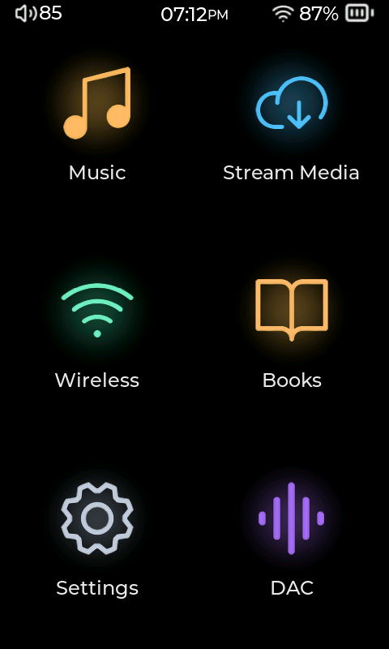

# Compás Player user manual

Play music, organize your library, connect your headphones, and make the player your own.

This guide describes the development version checked on 23 October 2026. Your release may have slightly different menus. Compás is tested on the HiBy R1; see [Before you start](00-before-you-start.md) for the other models.

> The pictures are existing R1 screenshots, reused for this first edition. Some show older menus, layouts, or plugins. Follow the written menu paths when a picture differs. A new screenshot session is planned; the lyrics example will use **“Abril” by Malpaís**.

## Start here

If Compás is already installed, go straight to [First steps](02-first-steps.md).

1. [Before you start](00-before-you-start.md): devices, downloads, and what you need.
2. [Install and update](01-install-and-update.md): full firmware, player updates, and recovery.
3. [First steps](02-first-steps.md): setup, copy music, play a song, and learn the controls.

## Make it yours

[Plugins](07-plugins.md) add features and tools. [Themes](08-personalize.md#choose-a-theme) change the interface's appearance. [Now Playing layouts](08-personalize.md#choose-a-now-playing-layout) arrange the artwork and controls on the player screen. Choose each separately.

## Use your player

| Guide | What you can do |
|---|---|
| [Your music library](03-library.md) | Browse, search, scan, manage favorites and edit playlists. |
| [Playback](04-playback.md) | Use Now Playing, the queue, lyrics, play modes, gapless and resume. |
| [Sound](05-sound.md) | Adjust equalization, ReplayGain, filters and optional sound tools. |
| [Connections](06-connections.md) | Connect Wi-Fi, Bluetooth, USB, remote control and network audio. |
| [Plugins](07-plugins.md) | Install, update, enable and remove optional features. |
| [Personalize Compás](08-personalize.md) | Choose themes, fonts and layouts; arrange menus and controls. |
| [Books, audiobooks and podcasts](09-books.md) | Read text and use optional spoken-audio and EPUB tools. |
| [Battery and power](10-power.md) | Configure charging, screen timeout, sleep timer and shutdown. |
| [Troubleshooting](11-troubleshooting.md) | Resolve common problems and collect useful bug reports. |
| [Settings and storage reference](12-reference.md) | Find settings, folders, formats and hardware-control notes. |

**Menu paths** use the English labels, such as **Settings > Updates > Player Update**. If your player uses another language, look for the matching translated labels. Plugins and custom layouts can add or rearrange controls.

For screenshot replacements and website integration, see the [editorial handoff](EDITORIAL.md). That page is for maintainers, rather than part of the reading path above.
